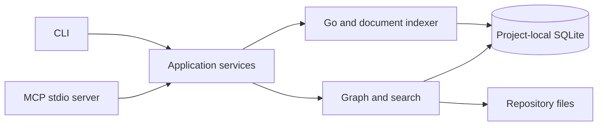

# CodeKB

CodeKB is an offline-first, project-local code knowledge base for Go repositories. It is being built as one Go binary that will index source structure, static call relationships, documentation, and searchable code context for developers and Codex through MCP.

> Development status: **M0 engineering skeleton is implemented.** Indexing, SQLite storage, search, and MCP commands are planned milestones and are not available yet.

## Architecture



CodeKB differs from CodeGraph by being an independent, Go-focused implementation with no runtime dependency on CodeGraph. Unlike ordinary RAG, its planned core combines exact symbols and static call edges with full-text retrieval; optional local embeddings are an enhancement, not a prerequisite.

## Build and test

Requirements: Go 1.25 or newer. The M0 build is verified on macOS arm64.

```bash
make check
make build
./bin/codekb --help
```

The same build can be run directly:

```bash
go test ./...
go build -o codekb ./cmd/codekb
```

## CLI roadmap

The M0 binary currently supports `--help` and `--version`. These commands will be added milestone by milestone:

| Command | Purpose | Milestone |
| --- | --- | --- |
| `init`, `status` | Initialize and inspect a project-local index | M1 |
| `index`, `symbol` | Build the Go/document structure index | M2 |
| `search`, `callers`, `callees`, `impact` | Query text and call relationships | M3 |
| `mcp`, `install codex` | Serve and register read-only MCP tools | M4 |
| `update`, `watch`, `doctor` | Incremental indexing and diagnostics | M5 |

## Planned project configuration

`codekb init` will create `.codekb/config.yaml` with a versioned schema. The model already defines project name/root, include and security-focused exclude patterns, file-size limits, result limits, and an optional local Ollama endpoint. M1 will add YAML loading, canonical root validation, safe initialization, and SQLite migrations.

```yaml
schema_version: 1
project: {name: example, root: ".."}
index:
  include: ["**/*.go", "**/*.md", "**/*.txt"]
  exclude: [".git/**", ".codekb/**", "vendor/**", "node_modules/**", "**/.env*", "**/*secret*", "**/*.pem", "**/*.key", "**/*_generated.go"]
  max_file_bytes: 1048576
search: {default_limit: 10, max_limit: 50}
embedding:
  enabled: false
  provider: ollama
  base_url: http://127.0.0.1:11434
  model: nomic-embed-text
  batch_size: 16
```

Indexes will live only under the target project's `.codekb/` directory. That directory is a disposable cache: delete it to remove the local index and run the future `codekb init`/`codekb index` commands to rebuild it.

## Codex MCP integration

M4 will add a stdio MCP server and a dry-run-first project registration command. The intended verification flow is:

```bash
codekb install codex --scope project --dry-run
codekb install codex --scope project
codex mcp list
codex mcp get codekb
```

The server will reserve stdout for MCP protocol messages, write diagnostics to stderr, open only an existing index, and restrict source reads to the configured project root.

## Accuracy, privacy, and limitations

- The first release supports Go source and Markdown/TXT documents only.
- Call relationships will represent statically resolved evidence, not runtime guarantees. Interface dispatch, reflection, function variables, and cross-process RPC will never be presented as certain edges without evidence.
- Source, vectors, and credentials remain local. Network access is disabled by default; optional embeddings will call only the explicitly configured Ollama endpoint.
- Hidden configuration, `.env`, keys, certificates, `.git`, `.codekb`, `vendor`, and `node_modules` are excluded by default.
- CodeKB is read-only through MCP and will not execute or modify indexed projects.

## Troubleshooting

- If the binary does not build, confirm `go version` satisfies `go.mod`, then run `go mod download` and `make check`.
- Index and MCP troubleshooting will be documented when those commands exist; M0 deliberately does not expose placeholders that appear functional.

## Contributing

Read [`docs/CodeKB_项目设计与Codex开发指南.md`](docs/CodeKB_%E9%A1%B9%E7%9B%AE%E8%AE%BE%E8%AE%A1%E4%B8%8ECodex%E5%BC%80%E5%8F%91%E6%8C%87%E5%8D%97.md) before making changes. Keep work within one milestone, add focused Go tests, and run `make check` before submitting it.

## Roadmap

- M0: engineering skeleton — implemented
- M1: project initialization and storage
- M2: Go structure indexing
- M3: full-text and graph queries
- M4: MCP and Codex integration
- M5: optional semantic retrieval and incremental indexing
